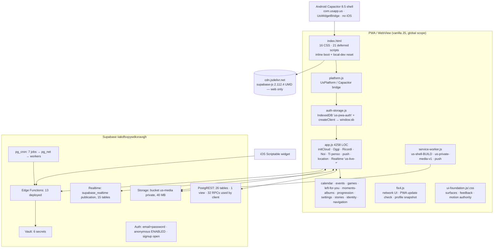

# US 2.0 — F0 Foundation Baseline & Backend Inventory

**Mission:** F0 only — baseline, inventory, evidence. No code, schema, grant, RLS, Auth, Edge Function, cron, Storage or data change was made.
**Date:** 2026-10-03
**Branch:** `mission/us-2-0-f0-foundation-baseline` (created from `origin/main`)

---

## 1. Source

| Item | Value |
|---|---|
| `origin/main` after `git fetch origin` | `c8de18dd650487e39196b2014ce479314fe1c1c0` (= expected SHA, main has not moved) |
| Branch base | `c8de18dd650487e39196b2014ce479314fe1c1c0` |
| Build id (`version.json`, SW `BUILD_ID`, `?v=` query in `index.html`) | `us-gioca-weekly-remaining-v1-20261003-1` |
| Supabase project | `iiakdfsxpywdkxravqjh` (Postgres 17.6, eu-west-3) |

### How production was inspected (read-only)

- Supabase CLI 2.117.0, already authenticated. Every SQL statement went through `supabase db query --linked` (Management API), wrapped as `begin transaction read only; …; commit;`. A probe confirmed `transaction_read_only = on`.
- Also used: `supabase functions list`, `supabase secrets list` (names only, digests not recorded), `supabase db advisors --type all`, `supabase config diff` (remote Auth/API config, no secret fields).
- **Side effects to disclose (not app data):**
  1. When it ran `--linked` queries and advisors, the CLI printed `Initialising login role...`. This is the CLI's own temporary database login role, set up through the Management API. It is not an app schema or data change, but it is a production-side action.
  2. The CLI wrote a local `supabase/.temp/` folder (project ref cache). I deleted it before the final test run, and it was never committed.
- **Not available:** Supabase platform logs (API/Postgres/Edge/Auth). CLI 2.117 has no logs command, and reading them would require extracting the account access token, which I did not do. §12 uses DB-side evidence instead (`cron.job_run_details`, `net._http_response`, `pg_stat_statements`, `push_event_log`).

---

## 2. Test / build baseline

All commands ran from the clean branch on Windows 11, Node v24.15.0, npm 11.12.1.

| Command | Result | Classification |
|---|---|---|
| `npm ci` | added 112 packages; `npm audit`: 4 vulns (3 moderate, 1 high). `npm audit --omit=dev`: **0** | dev-only advisories |
| `npm test` (`node --test`), run 1 | tests 1292 · **pass 1222 · fail 37 · skipped 33** · 61.8 s · exit 1 | see below |
| `npm test`, run 2 (clean tree, after deleting `supabase/.temp`) | tests 1292 · **pass 1222 · fail 37 · skipped 33** · 59.0 s · exit 1 | identical |
| `npm run build:cloudflare-pages` | `Cloudflare Pages bundle: 141 files -> dist/cloudflare-pages` · exit 0 | PASS |
| `npm run build:capacitor-web` (+ prebuild `assets:widget`, `assets:web-brand`) | `Approved widget assets synchronized` · `Web brand derivative verified` · `Capacitor web bundle: 139 files · 2b8f465b…a8866e` · exit 0 | PASS |

**The 37 failures:**

| Count | Files | Root cause | Class |
|---|---|---|---|
| 36 | `m10-daily-question-push` (12), `m9a-left-for-you-push-reliability` (10), `m11d-game-v2-push` (6), `m11b-game-v2-editorial` (5), `m11c-game-v2-recipes` (3) | `import(path.join(ROOT, '…'))` passes a Windows absolute path (`F:\…`) to the ESM loader → `ERR_UNSUPPORTED_ESM_URL_SCHEME … Received protocol 'f:'` (e.g. `tests/m11b-game-v2-editorial.test.js:12`, `tests/m10-daily-question-push.test.js:14`) | **Tooling / Windows portability.** I re-ran each file directly with a scratchpad-only loader shim (`pathToFileURL`, no repo change): m10 17/17, m11b 5/5, m11c 4/4, m11d 9/9, m9a 14/14. **All 49 tests in those files pass.** |
| 1 | `scriptable-widgets.test.js:484` ("…does not add … Android … build changes") | Asserts a clean `git status`. Earlier in the same run, `n3-android-brand-assets.test.js:23` runs `scripts/build-android-brand-assets.mjs`, which rewrites `android/brand-assets-manifest.json` with **line-ending-only** changes (`git diff --ignore-cr-at-eol --stat` and `git diff -w --stat` are both empty). | **Test self-interference on Windows.** Alone on a clean tree, `node --test tests/scriptable-widgets.test.js` gives 23/23 pass. I restored the manifest with `git checkout`. |

**Skipped 33:** real-Postgres race suites (`m11b-game-v2-concurrency`, `m11c-game-v2-real-pg`, `m11f…`, `m12b-3…race`, `m12b-4…race`). They are gated by `tests/helpers/game-v2-pg.js:15` (`'no local PostgreSQL server binaries / postgres OS user / root available'`). **The concurrency guarantees these tests prove were not exercised on this machine.**

**Conclusion:** no application-logic failure was observed. The baseline is *not green on Windows* for two harness reasons, and the race-test tier needs a Linux/PG runner.

---

## 3. Architecture

**Boot order** (`index.html:40–115, 847–862`):
1. Inline: add `us-auth-pending`, read `us:fix4:last-profile`, 6 s safety timeout.
2. Local-dev SW reset (only on `localhost` with `?us-dev=1`).
3. `platform.js` → `auth-first-run.js` → `ti-penso-widget.js` → `fastboot2.js` → supabase-js from CDN.
4. `auth-storage.js` → `app.js` → `progression.js` … `ui-foundation.js` (all `defer`).
5. `app.js:4251 initCloud()`, then SW registration on `load` (`app.js:4250–4256`).

**Build pipelines**
- *Cloudflare Pages*: `scripts/build-cloudflare-pages.mjs` copies a hard-coded `RUNTIME_FILES` list + all of `assets/` + `cloudflare/_headers`. Vercel is disabled (`aa1bce3`).
- *Capacitor*: `scripts/build-capacitor-web.mjs` copies its own `RUNTIME_FILES` list, vendors `node_modules/@supabase/supabase-js/dist/umd` to `/vendor/supabase.js`, and bundles `native-entry.mjs` with esbuild. It then **rewrites `index.html` with regexes**: removes the manifest, sets `__US_LEFT_FOR_YOU_ACTIVE__ = false`, strips the Left For You entry and overlay, replaces the profile-photo action with Stories, and swaps the CDN for the vendor file.

---

## 4. Frontend runtime inventory

All modules share one global scope (`window.sb`, `window.usProfile`, ~150 `window.*` assignments; `app.js` alone has 97). No module system. No module ever calls `removeEventListener`, except `events.js` (1), `moments-albums.js` (1), `stories.js` (2) and `ui-foundation.js` (8).

| Module (LOC) | Purpose / domain | Supabase surface | Timers / listeners / channels it owns | Cleanup | Main risk |
|---|---|---|---|---|---|
| `app.js` (4258) | Auth boot (`initCloud`), Oggi/Today, Ricordi grid + delete commit, Noi/Bond/Quest/Da vivere, Ti penso, distance/location, web push, push navigation, Realtime | tables: profiles, couples, moments, bucket_items, bond_*, couple_locations, daily_*, living_provenance, relationship_event_history, shared_messages, shared_event_completions, think_reactions; 21 RPCs; Storage `us-media`; Edge `delete-moment`, `widget-device-token`, `send-web-push`/`game-v2-push` via `fetch` | `setInterval` ×3 (`app.js:811` location 5 min, `:1078` home photo 60 s, `:4234` refreshVisibleState 60 s); channel `us-live-${uid}` (11 `postgres_changes`, `app.js:3840`); `visibilitychange` `:4235`; `online` `:3148`; `onAuthStateChange` `:4236`; 46 `addEventListener`, 0 removals | Channel replaced on restart only; never removed on sign-out (sign-out reloads the page) | God-file; `initCloud` re-runs on every non-INITIAL/TOKEN_REFRESHED auth event; global mutable state |
| `auth-storage.js` (154) | Durable auth storage adapter (IndexedDB `us-pwa-auth`/`sessions`, migrates legacy localStorage), creates `window.sb` | Auth | none | n/a | Auth persistence authority; must be preserved |
| `auth-first-run.js` (104) | PWA install prompt / first run | — | 4 listeners | — | low |
| `platform.js` (192) | `UsPlatform`: native detection, plugin registry, back button, `appUrlOpen`, widget snapshot | — | native `backButton`, `appUrlOpen` listeners | listener handles kept | No `appStateChange`; relies on WebView `visibilitychange` |
| `ti-penso-widget.js` (139) | Android widget snapshot + credential provisioning | via `UsWidgetCredentialApi` → `widget-device-token` | — | `clear()` on logout | low |
| `fastboot2.js` (68) | First paint of the cached home photo (`us:home-photo:boot:v1`, `/__us_media_cache__`) | — | — | — | low |
| `fix4.js` (303) | Offline/online banner, profile snapshot rescue, double-tap guard, viewport, **PWA update check/apply**, MutationObserver on `body` (subtree, attributes) | — | `setInterval` 5 min version check (`fix4.js:244`), profile snapshot poll ×40 (`:297`), `online`/`offline`/`visibilitychange`/`resize`/`focusin`/`focusout` | none | Update applies via `location.replace` without awaiting `controllerchange` (`fix4.js:219–233`); body-wide MutationObserver cost |
| `calendar-domain.js` (186) | Pure calendar domain logic | — | — | — | none (well isolated) |
| `calendar.js` (1505) | Calendar UI (presets, start/end time, reminders, week view, Oggi widget) | calendar_entries, calendar_reminders, profiles | 29 listeners | — | Writes have no idempotency key or revision check |
| `events.js` (246) | Events overlay, complete event | shared_events, shared_event_completions, relationship_milestones, couples; RPC `complete_shared_event` | `setInterval` 300 ms deep-link boot poll (`events.js:244`, self-cleared on profile or timeout) | yes | low |
| `games.js` (924) | Gioca / Game V2: Per voi, Swipe, families, weekly question | 9 RPCs | `setInterval` 45 s `refresh()` (`games.js:923`), `visibilitychange` (`:922`), boot `setTimeout(boot,250)` loop while logged out (`:912`) | none | Polls `get_game_v2_home` every 45 s on **any** page; endless 250 ms boot loop on the login screen |
| `left-for-you.js` (1484) | "Lasciato per te" envelope, composer (text/photo/audio/video/music), conserve | left_for_you, profiles, Storage, RPCs `mark_left_item_seen`, `conserve_left_for_you`; Edge `spotify-search` | channel `us-left-for-you-${uid}` (`:513`); recorder intervals (cleared); `us-auth-resolved` | channel replaced on re-auth | Disabled in the native build by HTML regex |
| `moments-albums.js` (1042) | Ricordi albums, Conservati, chapters, delete with undo | moment_photos, conserva_contributions, left_for_you, profiles, Storage | `visibilitychange` (`:605`) | partial | Undo window is a client timer; delete only commits if the app stays alive |
| `navigation.js` (333) | Internal history / back stack | — | 2 listeners | — | low |
| `progression.js` (432) | Sintonia/progression, rewards, device-local cosmetics | RPCs `get_progression_v1`, `ack_progression_unlock` | — | — | Cosmetic prefs key (`devicePreferenceKey`) is not cleared on logout (low sensitivity) |
| `settings.js` (620) | Settings, notifications, Scriptable widget setup, logout, **legacy anonymous→email "upgrade" flow** | profiles, couples, moments, stories, shared_event_completions; RPCs `get/set_notification_preference`; Edge `widget-scriptable-setup` | `setInterval` profile wait (`:609`, 30 s cap); `visibilitychange`/`online`/`offline` | yes | `location.reload()` after sign-out (`settings.js:572`); dormant upgrade flow (`settings.js:458–561`, `app.js:1245` `us:account-upgrade`) |
| `stories.js` (997) | Stories (partner bubble entry, viewer, camera, 24 h) + Today auto-close wrapper | stories, story_views, profiles, Storage | channel `us-stories-${uid}` (`:888`); `setInterval` 30 s stories + 120 s profiles (`:896,:900`); boot `setInterval` 450 ms (`:969`) until a profile exists; `visibilitychange`, `focus`, own `onAuthStateChange` (`:989`) | timers replaced on restart | Re-initialises (channel + polling) on **every** auth event, including `TOKEN_REFRESHED`; boot interval never stops while logged out; the #2 client query in production (§12) on a table with 0 rows |
| `identity.js` / `polish4.js` (43/93) | Visual identity / polish patches | — | 1/1 listener | — | Patch layering (`fix4`, `polish4`, `settings2.css`) |
| `ui-foundation.js` (569) | Cross-cutting UI primitives authority | — | visibility, audio context | **yes** (8 removals) | Reference implementation for lifecycle hygiene |
| `service-worker.js` | Shell cache, private media cache, push, notification click | Storage signed URLs (image) | `install`/`activate`/`fetch`/`push`/`notificationclick`/`message` | old shell caches deleted on activate | See §10 |

**CSS layers** (16 stylesheets, 424,622 B raw / 85,397 B gzip): `styles.css` (107 KB) → `ui-foundation.css` → `fix4.css` → events, moments-albums, games and settings2 (async `media=print` swap) → progression, settings, identity, polish4, stories, left-for-you, calendar, state-system, auth-first-run.

---

## 5. Backend object inventory

### 5.1 Totals (verified in production)

| Object | Count |
|---|---|
| `public` base tables | **57** (all RLS-enabled, none FORCE RLS) |
| `public` views | **1** (`relationship_event_history`, `security_invoker=true`) |
| RLS policies (`public`) | **73** across 34 tables; **23 tables RLS-on with 0 policies** (RPC/service-only by design) |
| Functions `public` | **70** (67 SECURITY DEFINER, 3 invoker) |
| Functions `private` | **75** (29 SECURITY DEFINER, 46 invoker) |
| Triggers (`public`, non-internal) | 20 |
| Edge Functions deployed | **13** (repo: 13 dirs; the sets differ, §8) |
| pg_cron jobs | **7**, all active |
| Storage buckets | **1** (`us-media`, private), 51 objects / 84 MB |
| Vault secrets | 6 |
| Realtime publication tables | 15 |
| Auth users | **11** = 3 permanent (email) + **8 anonymous**; 2 with a `profiles` row |
| Migrations | remote history 80; repo 44; **36 remote-only baseline migrations**; 10 repo migrations recorded remotely under different versions |

### 5.2 Tables / views

Rows are exact `count(*)`. "Last write" is the newest timestamp column. Client = direct PostgREST from the web client.

| Object | Rows | Policies | Client direct | Indirect users | Last write | Category |
|---|---|---|---|---|---|---|
| profiles | 2 | 2 | yes (16 refs) | `current_couple_id()`, every RPC/Edge Function | 2026-08-20 | CORE |
| couples | 1 | 2 | yes | progression, widget state | 2026-08-18 | CORE |
| moments | 17 | 4 | yes | `delete-moment`, progression trigger, game ctx | 2026-09-07 | CORE |
| moment_photos | 9 | 4 | yes | `delete-moment` | 2026-08-31 | CORE |
| shared_messages (kind `think` only: 69) | 69 | 3 | yes | `send_think`, widget think, push | 2026-10-03 | CORE |
| think_reactions | 8 | 1 | yes | push | 2026-10-03 | CORE |
| daily_questions | 35 | 1 (`true`) | yes | cron materialize, push | 2026-10-02 | CORE |
| daily_answers | 32 | 3 | yes (upsert) | progression trigger | 2026-10-02 | CORE |
| daily_question_outcomes | 2 | 1 | yes | RPC | 2026-10-01 | CORE |
| daily_question_keepsakes | 0 | 1 | yes | `keep_daily_question` | — | CORE |
| daily_question_reveal_states | 4 | 0 | no | reveal RPCs | 2026-10-01 | ACTIVE_INTERNAL |
| daily_question_templates | 182 | 0 | no | `materialize_daily_question` | 2026-09-30 | ACTIVE_INTERNAL |
| calendar_entries | 10 | 7 | yes | reminders worker, Da vivere triggers, game ctx | 2026-10-02 | CORE |
| calendar_reminders | 0 | 4 | yes | `calendar-reminders-worker` (cron 1 min) | — | CORE |
| left_for_you | 31 | 2 | yes | push worker, cleanup (not deployed) | 2026-10-03 | CORE |
| conserva_contributions | 8 | 1 | yes | `conserve_left_for_you` | 2026-10-03 | CORE |
| shared_events | 4 | 4 | yes | `complete_shared_event`, widget | 2026-08-28 | CORE |
| shared_event_completions | 2 | 1 | yes | progression trigger, view | 2026-10-01 | CORE |
| relationship_milestones | 2 | 1 | yes | monthiversary job, progression | 2026-09-21 | CORE |
| relationship_event_history (view) | — | invoker | yes | — | — | CORE |
| couple_locations | 2 | 3 | yes | Realtime | 2026-10-03 | CORE |
| bond_weekly_quests / bond_weekly_state / bond_quest_templates | 21 / 7 / 33 | 1 / 1 / 1 | yes | quest RPCs, progression | 2026-09-28 | CORE (Couple Quest) |
| couple_questions | 0 | 0 | no | weekly question RPCs, game push | — | CORE (via RPC) |
| game_sessions / _items / _sides / _answers | 3 / 15 / 6 / 30 | 0 | no | Game V2 RPCs, push, progression | 2026-10-01 | CORE (via RPC) |
| game_v2_catalog / game_v2_recipes / game_v2_cooldowns | 62 / 13 / 6 | 0 | no | Game V2 selection | 2026-09-30 | ACTIVE_INTERNAL |
| progression_events / progression_reward_catalog / couple_reward_unlocks / progression_reward_views / couple_progression_preferences | 55 / 27 / 7 / 14 / 1 | 0 | no | progression RPCs/triggers | 2026-10-03 | CORE (via RPC) |
| notification_preferences | 2 | 3 (role `public`) | via RPC | all push workers | 2026-08-20 | CORE |
| push_subscriptions | 5 | 0 | via RPC | push core | 2026-10-03 | ACTIVE_INTERNAL |
| push_event_log | 142 | 0 | no | dedupe for every push path | 2026-10-03 | ACTIVE_INTERNAL |
| widget_tokens / widget_action_tokens / widget_action_receipts | 3 / 194 / 3 | 0 | no | widget Edge Functions, cron 2 | 2026-10-03 | ACTIVE_INTERNAL |
| widget_scriptable_installations / _setup_codes | 1 / 1 | 0 | no | Scriptable setup/state | 2026-09-25 | ACTIVE_INTERNAL |
| living_provenance | 0 | 1 | yes (read) | `link_moment_to_source` (no client caller), game ctx | — | UNKNOWN (writer not wired in client) |
| bucket_items | 1 | 4 | yes (6 refs) | `calendar_entries_unschedule_bucket_items` trigger, `game_v2_ctx_da_vivere/_calendar`, `confirm_bucket_item_lived`, `claim_us_role` | 2026-08-19 | COMPATIBILITY (Da vivere no longer exposed; DB triggers still depend on it) |
| activity | 19 | 2 | no | written by `confirm_bond_quest_internal`, `complete_shared_event`, `award_relationship_milestone`, `complete_partner_knowledge_deck` | 2026-10-01 | COMPATIBILITY (write-only log) |
| stories / story_views | 0 / 0 | 3 / 2 | yes | Realtime, `claim_us_role` | never written | UNKNOWN (live code with a partner-bubble entry, not in the product brief) |
| couple_invites | 2 (both used) | 0 | no | `claim_us_role` only | 2026-08-18 | LEGACY_CANDIDATE |
| quiz_sets / quiz_questions / quiz_responses | 36 / 252 / 410 | 1 / 1 / 1 | no | `get_quiz_state`, `save_quiz_answer`, `get_weekly_*_sets`, partner-knowledge RPCs, `claim_us_role` | 2026-09-30 (`quiz_responses.updated_at`; writer unknown) | LEGACY_CANDIDATE (Gioca v1) |
| partner_knowledge_attempts / weekly_quiz_rewards | 12 / 14 | 1 / 1 | no | v1 RPCs | 2026-08-31 | LEGACY_CANDIDATE |
| moods | 0 | 3 | no | `claim_us_role` | never | LEGACY_CANDIDATE |
| device_push_tokens | 0 | 2 | no | `register_push_token` (no caller), `claim_us_role` | never | LEGACY_CANDIDATE (native push not wired) |

**Do NOT remove despite no direct client reference:** daily_question_templates, daily_question_reveal_states, push_event_log, push_subscriptions, widget_* tables, game_v2_*, couple_questions, game_session_*, progression_* tables, activity (written by live RPCs), bucket_items (FK/trigger coupling with calendar_entries and the game context).

### 5.3 RPCs / functions

**Used by the client (32):** ack_progression_unlock, complete_game_session_side, complete_shared_event, confirm_bond_quest, confirm_bucket_item_lived, conserve_left_for_you, create_weekly_question, delete_daily_question_outcome, dismiss_daily_reveal_notice, ensure_bond_week, get_daily_reveal_meta, get_daily_state, get_game_session, get_game_v2_home, get_notification_preferences, get_or_create_daily_question, get_progression_v1, keep_daily_question, mark_daily_reveal_seen, mark_game_session_reveal_seen, mark_left_item_seen, register_web_push_subscription, remove_web_push_subscription, reroll_bond_quest, save_daily_question_outcome, save_game_session_answer, send_think, set_daily_answer_reaction, set_notification_preference, set_think_reaction, start_game_round, start_swipe_round.

**Used by Edge Functions / cron only (service role):** get_internal_{calendar_reminders,daily_question_push,game_v2_push,left_for_you_push,monthiversary}_cron_key, get_internal_vapid_private_key, claim/complete/finalize_left_for_you_cleanup, game_v2_pending_pushes, game_v2_push_for_session, game_v2_push_for_weekly, widget_scriptable_{exchange,issue_code,revoke}_internal, widget_send_think_internal, award_relationship_milestone (expected caller: `monthiversary-job`, whose source is not in the repo), `private.materialize_daily_question` (cron 5/6).

**Used by RLS / triggers:** `private.current_couple_id()` (root of nearly every policy), `private.daily_question_reveal_ready`, calendar_reminder_offset_valid / calendar_reminder_recipient_in_couple (not defined in repo migrations → baseline), all `private.*_trigger` / `*_guard_*`.

**Granted to `authenticated` but with no caller in client, Edge Functions or cron:**

| Function | Notes |
|---|---|
| **claim_us_role** | **P0 — see §7.1** |
| equip_progression_reward | equipped cosmetics are now device-local (`progression.js:55–80`) |
| get_web_push_status | not referenced anywhere in the repo (baseline-only) |
| link_moment_to_source | M12B provenance writer; no client call → `living_provenance` 0 rows |
| list_game_sessions, list_couple_questions, get_weekly_question_state, update_couple_question, archive_couple_question | M11A surface superseded by Game V2 home |
| register_push_token | native push not wired; `device_push_tokens` 0 rows |
| save_quiz_answer, get_quiz_state, get_partner_knowledge_hub, complete_partner_knowledge_deck, get_weekly_game_sets, get_weekly_quiz_sets | Gioca v1 |

**SECURITY DEFINER exposure** (`has_function_privilege`):

| Grant | Functions | Internal caller check |
|---|---|---|
| `anon` EXECUTE (8) | complete_partner_knowledge_deck, complete_shared_event, get_notification_preferences, get_partner_knowledge_hub, get_weekly_game_sets, get_weekly_quiz_sets, register_push_token, set_notification_preference (the last four also have the PUBLIC grant) | **All 8 start with `if uid is null then raise exception 'Authentication required'`** (verified in `prosrc`). Risk: LOW (defense-in-depth only). |
| `authenticated` EXECUTE (47 public) | advisor list `authenticated_security_definer_function_executable` | Sampled bodies check `auth.uid()` + `profiles.couple_id`. `claim_us_role` is the exception that matters. |
| `private.*` granted to authenticated | current_couple_id, daily_question_reveal_ready, ensure_bond_week_internal, confirm/reroll_bond_quest_internal | `private` is not an exposed API schema; called via invoker wrappers |
| `private.us_touch_updated_at` | PUBLIC/anon/authenticated | trigger-only function; cannot run outside trigger context. LOW |

All 145 non-extension functions pin `search_path` (`proconfig` contains `search_path`).

---

## 6. Auth / RLS / security findings

### 6.1 Auth configuration (remote, from `supabase config diff`)

| Setting | Remote value | Expected for "email + password only" |
|---|---|---|
| `enable_anonymous_sign_ins` | **true** | false |
| `enable_signup` | default **true** (no diff from local default) | false (private 2-person app) |
| `sms.twilio.enabled` | **true** | false |
| `site_url` | `https://us-francesco-beatrice-app.vercel.app` | Cloudflare Pages origin (Vercel disabled in `aa1bce3`) |
| `additional_redirect_urls` | only the Vercel URL | current origin(s) |
| `email.enable_confirmations` | true | ok |
| `enable_manual_linking` | true | needed only by the legacy anon→email upgrade |
| `mfa.totp.enroll/verify` | true | unused |
| Leaked-password protection | **off** (advisor `auth_leaked_password_protection`) | on |

**Accounts:** 11 users. 3 email users (2 linked to profiles, **1 with no profile**). **8 anonymous users** (created 2026-08-18 → 2026-08-20, none with a profile). Their 8 sessions were last refreshed **2026-09-20**. Identities: `email` 3. Sessions: 35 live across 11 users. Refresh tokens: 316 rows (34 unrevoked).

**Client login path:** `app.js:1196–1206` (`loginAccount` → `signInWithPassword`). `app.js:485–489` explicitly refuses to fall back to anonymous pairing. The client has **no** `signInAnonymously`/`signInWithOtp` call. Legacy code that remains: the `settings.js:458–561` anon→email upgrade UI, `app.js:1245` `us:account-upgrade` key, and the `claim_us_role` comment at `calendar.js:422`.

### 6.2 RLS

- 57/57 public tables have RLS enabled; 23 have zero policies and are reachable only through SECURITY DEFINER RPCs or the service role.
- **Root of authority:** `private.current_couple_id()` reads `profiles.couple_id` for `auth.uid()`.
- **`profiles` is self-updatable on authority columns:** column grants give `authenticated` (and `anon`) UPDATE on `avatar_path, couple_id, created_at, display_name, id, role`. Policy `profiles_update_self` is `USING/CHECK (id = auth.uid())`. There is **no trigger on `profiles`**. A user with a profile row can therefore set their own `couple_id`/`role` directly over PostgREST, which re-scopes `current_couple_id()` for every policy and Storage rule.
- **`shared_messages_update_recipient`** (`USING recipient_id = auth.uid()`) plus a column UPDATE grant on `body, sender_id, kind, couple_id, …`: the recipient can rewrite the content and sender of a message addressed to them.
- `couples_update_own` is limited by column grants to `home_photo_path, name, started_on`, which is correct. `bond_xp` is not writable.
- **Role `public` policies** (include `anon`): notification_preferences (3), partner_knowledge_attempts, relationship_milestones, shared_event_completions. They are effectively closed to anon because `auth.uid()` is null, but inconsistent.
- **Over-broad table grants:** `anon` holds `DELETE, INSERT, SELECT, TRIGGER, TRUNCATE, UPDATE, REFERENCES` on 20 public tables (profiles, moments, shared_messages, daily_answers, push_subscriptions, …). RLS denies by policy role, so this is defense-in-depth only. TRUNCATE is not subject to RLS, but PostgREST does not expose it.
- **Performance advisors:** `auth_rls_initplan` ×39 (policies call `auth.uid()`/`current_couple_id()` per row without `(select …)`, 18 tables); `multiple_permissive_policies` ×3 (calendar_entries); `unindexed_foreign_keys` ×45; `unused_index` ×12.

### 6.3 Storage

| Bucket | Public | Limit | MIME | Policies |
|---|---|---|---|---|
| us-media | **private** | 41,943,040 B (40 MB) | jpeg/png/webp/heic/heif, audio webm/mp4/mpeg/ogg, video mp4/webm/quicktime | SELECT: folder[1] = couple · INSERT: folder[1] = couple AND folder[2] = uid · UPDATE/DELETE: `owner_id = uid` AND same couple |

- Path convention: `{couple_id}/{user_id}/{avatar-|home-|story-|left/|moment-albums/{album}/}{ts}-{uuid}.{ext}` (`app.js:915,2235`, `left-for-you.js:1232`, `moments-albums.js:187`).
- **8 unreferenced objects (~2.5 MB):** 6 `story-*`, 1 old avatar `.jpg`, 1 old `home-*`. Expired stories leave storage behind. `delete-moment` logs `storage cleanup will need recovery` (`app.js:2673`), but no recovery job exists.
- Shared-Moment deletion by either partner goes through the `delete-moment` Edge Function (service role), because the `moments_delete_own` policy is creator-only.

---

## 7. Critical security finding

### 7.1 Legacy pairing (`claim_us_role`) is live and can take over a profile — **P0**

Evidence, from production:
1. Auth `enable_anonymous_sign_ins = true` (config diff; advisor `0012_auth_allow_anonymous_sign_ins` fires on 37 tables).
2. `public.claim_us_role(invite_code text, chosen_role text)` is SECURITY DEFINER with `authenticated` EXECUTE. Anonymous JWTs carry role `authenticated`.
3. The body **requires** an anonymous caller (`… or email is null into is_anon … if not is_anon then raise 'Anonymous session required for private pairing'`). It then matches `couple_invites.code_hash = sha256(upper(trim(code)))` for the chosen role.
4. It **never checks `used_at`/`used_by`** (both invites are already `used`: beatrice 2026-08-21, francesco 2026-08-28). There is **no expiry column and no attempt limit**.
5. When an existing profile owns that role, it creates a profile for the caller, **moves the old profile's data** (daily_answers, quiz_responses, bucket_items, shared_messages sender/recipient, moods, activity, couple_locations, device_push_tokens, moments, moment_photos, notification_preferences, partner_knowledge_attempts, push_event_log, push_subscriptions, shared_event_completions, shared_events, stories, story_views, widget_tokens, calendar_entries) to the caller, and then **`delete from public.profiles where id = old_uid`**.
6. The client no longer calls it. Only the comment at `calendar.js:422` mentions it.

Impact: anyone holding the publishable key (shipped in `app.js:65`) and either original invite code can create an anonymous session and silently take over Francesco's or Beatrice's profile and the couple's private data. The real user loses their profile. Newer tables (left_for_you, game_*, progression_*, think_reactions, daily_question_outcomes …) are not in the transfer list, so FK cascades or orphaned rows are also likely. Code entropy is unknown (only hashes are stored).

**Recommended mission: F1A** (Auth legacy shutdown). Do it first, as an atomic change: disable anonymous sign-ins and public signup, then revoke or neutralise `claim_us_role`, before any other work.

---

## 8. Cron / Edge Function inventory

### 8.1 Edge Functions

| Function | Deployed | In repo | verify_jwt | Caller | Auth inside | Env names used (values not read) | Class |
|---|---|---|---|---|---|---|---|
| send-web-push | v8 | yes | true | client `fetch` (`app.js:218`) | `getUser` + profile/couple | SUPABASE_URL, service key via `_shared/supabase-secret.ts` (SUPABASE_SECRET_KEYS / SUPABASE_SERVICE_ROLE_KEY) | user-facing |
| game-v2-push | v1 | yes | true | client `fetch` | `getUser` → `game_v2_push_for_*` | same | user-facing |
| delete-moment | v2 | yes | true | client `functions.invoke` | `getUser` + same-couple | same | user-facing |
| spotify-search | v1 | yes | true | `left-for-you.js:684` | `getUser` only (**any user, including anonymous**) | SPOTIFY_CLIENT_ID/SECRET | user-facing |
| widget-device-token | v3 | yes | true | `app.js:78,84` | `getUser` + profile | — | native widget |
| widget-scriptable-setup | v1 | yes | **false** | `settings.js:350–390` + Scriptable | `getUser` for issue; hashed setup code for exchange | — | widget |
| widget-think-send | v3 | yes | **false** | Android widget | hashed action token → `widget_send_think_internal` | — | widget-only |
| us-widget-state | v4 | yes | **false** | widgets | hashed state token | SUPABASE_SERVICE_ROLE_KEY | widget-only |
| calendar-reminders-worker | v1 | yes | false | cron 3 | `x-us-cron-key` vs Vault | — | cron-only |
| left-for-you-push-worker | v1 | yes | false | cron 4 | `x-us-cron-key` | — | cron-only |
| daily-question-push-worker | v1 | yes | false | cron 6 | `x-us-cron-key` | — | cron-only |
| game-v2-push-worker | v1 | yes | false | cron 7 | `x-us-cron-key` | — | cron-only |
| **monthiversary-job** | v4 (2026-08-20) | **NO** | false | cron 1 (hourly) | `x-us-cron-key` (assumed) | unknown | cron-only, **source missing from repo** |
| **cleanup-left-for-you** | **NO** | yes | false (config) | none | — | — | **not deployed, no cron** |

Project secrets (names only): SPOTIFY_CLIENT_ID, SPOTIFY_CLIENT_SECRET, SUPABASE_ANON_KEY, SUPABASE_DB_URL, SUPABASE_JWKS, SUPABASE_PUBLISHABLE_KEYS, SUPABASE_SECRET_KEYS, SUPABASE_SERVICE_ROLE_KEY, SUPABASE_URL. Vault: us_{calendar_reminders,daily_question_push,game_v2_push,left_for_you_push,monthiversary}_cron_key, us_web_push_vapid_private.

**Consequence of the drift:** 13 of 31 `left_for_you` rows are past `cleanup_eligible_at` (photo 4, text 8, video 1) and still exist. The M5I "ephemeral" lifecycle is **not enforced in production**.

### 8.2 pg_cron

| # | Job | Schedule | Target | Idempotency | 7-day runs | Still required |
|---|---|---|---|---|---|---|
| 1 | us-monthiversary-hourly | `5 * * * *` | `monthiversary-job` via pg_net | unknown (source missing); `relationship_milestones` + `award_relationship_milestone` (bool) | 168 ok | yes, but source must be recovered |
| 2 | us-widget-scriptable-state-expiry | `* * * * *` | inline `UPDATE widget_tokens SET revoked_at` | `revoked_at is null` guard | 10,080 ok | yes; could be `*/5` |
| 3 | us-calendar-reminders-dispatch | `* * * * *` | calendar-reminders-worker | per-reminder state | 6,700 ok | yes |
| 4 | us-left-for-you-push-sweep | `* * * * *` | left-for-you-push-worker | `push_event_log.dedupe_key` | 5,230 ok | yes |
| 5 | us-daily-question-materialize | `1 * * * *` | `private.materialize_daily_question` | unique per day | 79 ok | overlaps with job 6 |
| 6 | us-daily-question-push | `*/10 * * * *` | materialize + daily-question-push-worker | claim key (`23505` = deduplicated) | 463 ok | yes |
| 7 | us-game-v2-push | `*/10 * * * *` | game-v2-push-worker | role-based dedupe | 407 ok | yes |

- All 7-day runs `succeeded`. `net._http_response` (6 h retention): 798 responses, **all HTTP 200**, no timeouts.
- `cron.job_run_details`: **25,263 rows, 17 MB since 2026-08-20, no purge job** (~3.6k rows/day).
- Each worker invocation calls `get_internal_*_cron_key()` through PostgREST: 6,701 + 5,235 calls (`pg_stat_statements`) for a static secret.

---

## 9. Realtime / timer lifecycle map

### 9.1 Realtime channels

| Channel | Owner | Tables / filters | Created | Removed | Duplicate guard | Status callback | Auth change | Background |
|---|---|---|---|---|---|---|---|---|
| `us-live-${uid}` | `app.js:3840` | shared_messages (INSERT recipient=uid), think_reactions (INSERT, **no filter**), daily_answers, couple_locations, moments, moment_photos, shared_events, shared_event_completions, relationship_milestones, bond_weekly_quests (`couple_id=eq`), couples (UPDATE id=eq) | `initCloud` → `usRunWhenIdle(startUsRealtime,420)` | only when replaced on restart | `removeChannel` before re-create | **none** (`.subscribe()` bare) | re-created by each `initCloud` | none; relies on supabase-js reconnect + 60 s poll |
| `us-left-for-you-${uid}` | `left-for-you.js:513` | left_for_you INSERT/UPDATE/DELETE recipient=uid | `us-auth-resolved` (paired) | replaced on re-auth | yes | none | re-created | none |
| `us-stories-${uid}` | `stories.js:888` | stories (couple), story_views (INSERT viewer) | `startForCurrentProfile` | replaced | yes | none | **re-created on every auth event (incl. TOKEN_REFRESHED) after 700 ms** | none |

Publication `supabase_realtime` covers 15 tables. `quiz_responses` and `story_views` are published, but **`calendar_entries`, `calendar_reminders` and `game_*` are not**, so partner calendar changes and game progress arrive only through polling or visibility refresh.

No channel is explicitly removed at sign-out. Sign-out relies on `location.reload()` (`settings.js:572`). A `SIGNED_OUT` from token expiry or revocation (not user-initiated) goes through `initCloud` → login overlay, **with all three channels and every timer still alive**.

### 9.2 Timers / polls

| Owner | Cadence | Start | Stop | Dup guard | Background |
|---|---|---|---|---|---|
| `app.js:4234` refreshVisibleState | 60 s | script load | never | n/a (single call site) | skipped if `document.hidden` |
| `app.js:811` location check | 5 min | after `initCloud` | replaced on restart | `clearInterval` | skipped if hidden |
| `app.js:1078` home photo rotation | 60 s | hydrate home photo | replaced | `clearInterval` | runs |
| `games.js:923` refresh | **45 s, any page** | script load | never | none | skipped if hidden |
| `games.js:912` boot | 250 ms `setTimeout` loop | script load | when `usProfile` exists | — | **runs forever while logged out** |
| `stories.js:896/900` | 30 s / 120 s | profile start | replaced | `clearInterval` | skipped if hidden |
| `stories.js:969` boot | 450 ms `setInterval` | script load | when a profile starts | — | **runs forever while logged out** |
| `fix4.js:244` version check | 5 min | script load | never | `clearInterval` | skipped if hidden |
| `fix4.js:297` profile snapshot | ~40 ticks | script load | self | — | — |
| `events.js:244` deep-link boot | 300 ms | script load | profile or timeout | self | — |
| `settings.js:609` profile wait | interval | script load | profile or 30 s | self | — |
| `left-for-you.js:967/1173` recorder | 200 ms | recording | stop | `clearInterval` | — |

**Foreground resume fan-out** (`visibilitychange` → visible). These handlers all run independently, with no coordinator: `app.js:4235` (hydrateThink, location, page hydrate), `games.js:922` (`get_game_v2_home`), `stories.js:973` (startForCurrentProfile + refreshStories with profiles), `stories.js:987` (window `focus` → refreshStories again), `fix4.js:277` (version.json + profile snapshot), `settings.js:616`, `moments-albums.js:605`. supabase-js also auto-refreshes the token, and every resulting auth event triggers `initCloud` (full rehydrate + channel restart) plus a Stories re-init.

---

## 10. Cache / storage contract map

| Store | Key / name | Owner | Private data | Scope | Invalidation | Cleared on logout | Versioning |
|---|---|---|---|---|---|---|---|
| IndexedDB | `us-pwa-auth` / `sessions` | auth-storage.js | **yes (session tokens)** | device | supabase-js | via `signOut` | DB v1; migrates legacy localStorage |
| localStorage | `us:fix4:last-profile` | app.js/fix4.js/index.html/fastboot2.js | yes (ids, name, role) | device | overwritten on boot | **yes** (`clearPrivateDeviceState`) | none |
| localStorage | `us:signed-url-cache:v2` | app.js:92 | yes (signed URLs) | device | TTL in entries | yes | `v2` |
| localStorage | `us:boot:home-photo:v1`, `us:home-photo:boot:v1` | app.js:938 / fastboot2.js:6 | yes (storage path) | device | on change | yes | `v1` (two names for one concept) |
| localStorage | `us:push:subscription:${profileId}` | app.js:199 | endpoint metadata | device | push enable/disable | yes | none |
| localStorage | progression device prefs (`devicePreferenceKey()`) | progression.js | no (cosmetics) | device+profile | sanitised against unlocked rewards | **no** | `DEVICE_PREFS_VERSION` + v1 migration |
| localStorage | `us:account-upgrade` | app.js:1245 | yes (expected anon uid, email) | device | upgrade flow | no | none (legacy) |
| localStorage | `us-today-reveal-autoclosed:${uid}:${date}` | stories.js:923 | no | device | **never; one key per day** | no | none |
| localStorage | `us:settings:distance-unit`, `usLocationEnabled`, `us:feedback:sounds/haptics` | app/settings/ui-foundation | no | device | user | no | none |
| sessionStorage | `us:local-dev:service-worker-reset:v1` | index.html | no | tab | dev only | n/a | v1 |
| Cache Storage | `us-shell-${BUILD_ID}` | service-worker.js | no (shell) | device | old `us-shell-*` / `us-shell-static-runtime-*` deleted on activate | no (not private) | per build |
| Cache Storage | `us-private-media-v1` | service-worker.js | **yes (photos)** | device | LRU-ish prune at 100 entries; key = storage path | **yes** (`app.js:387`) | fixed name, protected by AGENTS.md |
| Memory | `window.usProfile`, `US_SIGNED_URL_CACHE`, `noiIdeaState`, module state | many | yes | tab | identity checks in some modules | page reload | — |
| Native | Widget snapshot via `UsWidgetBridge` (ownerHash, partnerName, timestamps) | ti-penso-widget.js | low | device | `clear()` on logout | yes | `schemaVersion: 1` |

**Service Worker contract risks** (`service-worker.js`):
- `install` calls `skipWaiting()` unconditionally (`:115`) and `activate` calls `clients.claim()` (`:137`). A new build takes control of an open session running the previous build's JS, and the old shell cache is deleted underneath it.
- `fix4.js:219–233 applyUpdate` posts `US_SKIP_WAITING`, then immediately calls `location.replace(?us-refresh)` without waiting for `controllerchange`. The `us-refresh` bypass branch (`:272–290`) mitigates the old reload loop.
- The navigation handler (`:292–310`) serves the cached `index.html` and writes the network copy into the **current** build's cache. A newer `index.html` can therefore be paired with an older SW, and its `?v=NEW` assets then fall through to stale-while-revalidate instead of the build cache, so they are uncached offline.
- The media cache stores `response.ok || response.type === "opaque"` (`:227`). `` loads (no `crossorigin` attribute anywhere in the client) are no-cors, so the response is opaque and its status is unknowable. An expired or failed signed URL can be cached permanently under the stable storage-path key (needs a repro).
- The web build loads supabase-js from `cdn.jsdelivr.net` (`index.html:114`). It is not in `APP_SHELL`, and the SW skips third-party requests (`:249`), so an offline cold start depends on the browser HTTP cache.

---

## 11. Native / Capacitor architecture

- Capacitor 8.5.0: `@capacitor/android`, `app`, `haptics`, local plugin `@us/widget-bridge` (`native-plugins/us-widget-bridge`). `capacitor.config.json`: `appId com.usapp.us`, `webDir dist/capacitor`, SystemBars css insets.
- Android: one `MainActivity.java`. Permissions: INTERNET, CAMERA, ACCESS_FINE/COARSE_LOCATION. `google-services` is applied only if `google-services.json` exists (`android/app/build.gradle:48–53`). **No push plugin**, `register_push_token` is not called, and `device_push_tokens` has 0 rows, so **native builds have no push**.
- `platform.js` gates the SW and PWA updates (`UsPlatform.canUseServiceWorker`, `canUsePwaUpdates`). The native runtime uses the bundled web assets without a SW. Back button and `appUrlOpen` go through `@capacitor/app`. **No `appStateChange` listener.**
- Native build diverges from web through regex HTML rewriting (§3): Left For You disabled, profile photo action → Stories.
- **iOS readiness:** no `ios/` project. The only iOS surface is the Scriptable widget (`integrations/widgets/scriptable`, Edge `widget-scriptable-setup`/`us-widget-state`).
- Widgets: Android `UsWidgetBridge` + `widget-device-token`/`widget-think-send`/`us-widget-state`. `widget_action_tokens`: 194 rows, **192 revoked**, 2 live, 2 device hashes (rotation churn, never purged).

---

## 12. Reliability findings

1. **No global error layer.** There is no `window.addEventListener('error')`, `unhandledrejection` or `onerror` in any runtime file or `index.html` (grep returned nothing). The only fatal-init fallback is the 6 s CSS-class timeout (`index.html:50`).
2. **Reload / navigation paths:**

   | Path | Location | Classification |
   |---|---|---|
   | `location.reload()` after sign-out | `settings.js:572` | intentional |
   | `location.replace(?us-refresh=ts)` on update tap | `fix4.js:232` | intentional, **questionable** (no `controllerchange` wait) |
   | SW `skipWaiting` on install + `clients.claim` | `service-worker.js:115,137` | **questionable** (silent takeover of live sessions) |
   | SW `skipWaiting` on message | `service-worker.js:120` | intentional |
   | Local-dev SW/cache reset + `location.replace` | `index.html:54–102` | intentional, dev-only |
   | Today auto-close `go('home')` after 10 s | `stories.js:938` | questionable (navigation owned by Stories module) |
   | Push `notificationclick` focus/openWindow | `service-worker.js:161` | intentional |
3. **Auth event amplification.** `app.js:4236` re-runs `initCloud` on `SIGNED_IN`, `SIGNED_OUT`, `USER_UPDATED`, `PASSWORD_RECOVERY`, `MFA_CHALLENGE_VERIFIED`. Each run does a profile fetch, `hydrateCloud`, Realtime restart, location timer restart, avatar hydrate, web push UI and Think. `stories.js:989` re-inits on **every** event, including `TOKEN_REFRESHED` (hourly and on resume).
4. **Silent Realtime failure.** None of the 3 channels passes a status callback, so `CHANNEL_ERROR`/`TIMED_OUT`/`CLOSED` are invisible. Recovery depends on the supabase-js socket reconnect plus the 45 s / 60 s / 30 s polls.
5. **Network recovery:** offline→online → `fix4.js:262` (toast, `hydrateCloud`, push UI, version check) + `app.js:3148` (Noi only) + `settings.js:617`. A failed RPC/REST call is logged via `console.warn` and usually shows a toast; there is **no retry/backoff helper**. Stale session: `initCloud` waits 420 ms once (`app.js:424`), then shows login. Expired auth: no explicit handler; RLS errors surface as empty states.
6. **Dormant surfaces still active:** Da vivere is hidden by CSS (`styles.css:508`), but `hydrateNoiIdeas()` still queries `bucket_items` on every Noi visit and in the boot-critical lane (`app.js:21,40,3866`). Stories polls every 30 s and is the **#2 client query in production** (7,212 calls since 2026-08-18; `pg_stat_statements`) for a table that has never had a row.
7. **Background load while visible (per minute, Home):** ~1.3× `get_game_v2_home`, 2× stories select, 0.5× profiles, 1× Today hydrate (multi-query), 1× home photo tick, plus Realtime.

### 12.1 Mutation idempotency

| Operation | Client call | Operation / request id | Revision check | Unique DB constraint | Server guard | Verdict |
|---|---|---|---|---|---|---|
| Ti penso | `send_think(operation_id)` `app.js:3781` | **yes** `usThinkOperationId` | — | `shared_messages(sender_id, think_operation_id) WHERE kind='think'` | yes (M9 final) | safe |
| Ti penso (widget) | `widget_send_think_internal(token_hash, action_id)` | **yes** action_id | — | `widget_action_receipts(token_id, action_id)` | yes | safe |
| Game start | `start_game_round` / `start_swipe_round(request_id)` | **yes** | — | `game_sessions(couple_id, started_by_role, create_request_id)` + one open per family | yes | safe |
| Weekly question | `create_weekly_question(request_id)` | **yes** | — | `couple_questions(couple_id, week_start) WHERE weekly` | yes | safe |
| Game answer save | `save_game_session_answer` | no | — | items immutable trigger | RPC upsert | safe (needs PG race tier) |
| Daily answer | `daily_answers` upsert `onConflict question_id,user_id` (`app.js:3898`) | no | no | `(question_id, user_id)` | — | safe (last write wins) |
| Daily outcome | `save_daily_question_outcome(operation_id, expected_revision)` | **yes** | **yes** | `(couple_id, question_id, author_role)` | yes | safe |
| Progression ack | `ack_progression_unlock(reward_id)` | no | — | `progression_events(couple_id, source_kind, source_key)` | idempotent set | safe |
| Moment delete | Edge `delete-moment` after client undo timer (moments-albums.js) | no | — | — | delete is idempotent; storage cleanup best-effort | **at risk**: undo timer is client-only; orphaned storage has no recovery |
| Calendar writes | `calendar_entries` insert/update/delete (`calendar.js:1033,1212,1219,1427`) | **no** | **no** | only `calendar_reminders(entry_id, recipient_id, offset_minutes)` | guard trigger on update | **duplicate insert on retry; lost update** |
| Left For You send | `left_for_you` insert (`left-for-you.js:1320`) | no | — | `media_path` unique for media kinds only | `composer.sending` UI flag | **text/music duplicate on retry** |
| Left For You conserve | `conserve_left_for_you` | no | — | `conserva_contributions(source_item_id)` | yes | safe |
| Push registration | `register_web_push_subscription` | no | — | `push_subscriptions(endpoint)` | upsert | safe |
| Push send | client `fetch send-web-push` (`keepalive`) | event reference id | — | `push_event_log.dedupe_key` | yes | safe |

---

## 13. Performance baseline (measured)

| Metric | Value |
|---|---|
| Runtime JS (20 files excl. SW) | 664,530 B raw · **181,411 B gzip** (largest: `app.js` 223,948 B raw / 60,649 B gzip; `calendar.js` 72,921 B; `left-for-you.js` 67,343 B) |
| Runtime CSS (16 files) | 424,622 B raw · **85,397 B gzip** (`styles.css` 107,084 B) |
| `index.html` | 69,484 B raw · 13,855 B gzip (all screens inline) |
| supabase-js UMD | 212,426 B raw · 54,455 B gzip (CDN on web, vendored on native) |
| Shell requests (cold, no SW) | 1 HTML + 16 CSS + 21 scripts (20 local + 1 CDN) + manifest + fonts/icons |
| SW `APP_SHELL` precache | 92 entries |
| Cloudflare bundle | 141 files · 18,103,504 B |
| Capacitor bundle | 139 files · 18,323,326 B (`native-entry.js` 10,500 B) |
| **Of which `assets/source/` masters** | **14 files · 15,013,693 B (83%) shipped in both bundles, referenced by no runtime file** |
| Boot Supabase reads (signed in, Home) | `getSession` → `profiles` select (`app.js:466`) → home photo + signed URL → `usRunWhenIdle`: Realtime subscribe, location, avatars, push status, `hydrateThink` (shared_messages/think_reactions), `hydrateToday` (`get_or_create_daily_question`, `get_daily_state`, …), Oggi calendar widget, `get_game_v2_home` (games boot), `get_progression_v1`, Left For You fetch + profiles, Stories profiles + stories + cleanup |
| Top client queries since 2026-08-18 | couple_locations 8,766 · **stories 7,212** · profiles 5,901 · shared_events 4,607 · shared_event_completions 4,588 · couples.started_on 4,587 · relationship_milestones 4,585 · quiz_responses (count, legacy) 4,543 |
| Statement timeouts | anon 3 s · authenticated 8 s · authenticator 8 s (+ lock_timeout 8 s) |

Duplication: four hand-maintained runtime file lists (`index.html`, `service-worker.js` APP_SHELL, `build-cloudflare-pages.mjs`, `build-capacitor-web.mjs`). Two keys exist for the boot home photo. Patch layers `fix4`/`polish4`/`settings2`/`identity` override base styles.

---

## 14. Legacy candidates (proof required before removal — nothing authorised)

| Object | Reason |
|---|---|
| `claim_us_role` (fn) | anonymous pairing, superseded by password login; **P0 exploitable** |
| `couple_invites` | only consumer is `claim_us_role`; both codes used |
| Anonymous Auth users (8) + their sessions | pre-password pairing devices; no profile |
| Email user without profile (1) | unexplained account; verify before action |
| Settings anon→email upgrade flow + `us:account-upgrade` | only reachable for anonymous sessions |
| Twilio SMS provider, TOTP MFA, manual linking | enabled, unused by client |
| `quiz_sets` / `quiz_questions` / `quiz_responses` | Gioca v1; superseded by Game V2 (`quiz_responses` written 2026-09-30, source unknown) |
| `partner_knowledge_attempts`, `weekly_quiz_rewards` | Gioca v1; last write 2026-08-31 |
| v1 RPCs: save_quiz_answer, get_quiz_state, get_partner_knowledge_hub, complete_partner_knowledge_deck, get_weekly_game_sets, get_weekly_quiz_sets | no caller |
| M11A RPCs: list_game_sessions, list_couple_questions, get_weekly_question_state, update_couple_question, archive_couple_question, create_couple_question, start_custom_game_session | no caller (last two already revoked from authenticated) |
| `equip_progression_reward` | cosmetics are device-local now |
| `get_web_push_status`, `register_push_token`, `device_push_tokens` | no caller / 0 rows |
| `moods` | 0 rows, no caller |
| `activity` | write-only log, never read |
| `bucket_items` + Da vivere client code/markup | not exposed; still queried; DB triggers depend on it (COMPATIBILITY) |
| `stories` / `story_views` / stories.js | 0 rows ever, heavy polling; product status undecided (UNKNOWN) |
| `living_provenance` / `link_moment_to_source` | writer not wired in client (UNKNOWN) |
| `monthiversary-job` (deployed only) | must be recovered into the repo, not removed |
| `cleanup-left-for-you` (repo only) | must be deployed + scheduled, or the lifecycle decision revised |
| `vercel.json` + Auth `site_url` Vercel origin | Vercel deployments disabled |
| `assets/source/**` in runtime bundles | masters shipped but unreferenced (do **not** touch the masters themselves) |

---

## 15. Production mutation points F1/F2 must handle carefully

1. Auth config: `enable_anonymous_sign_ins`, `enable_signup`, Twilio, `site_url`/redirects. Disabling anonymous sign-in does not end existing anonymous sessions.
2. `claim_us_role` revoke or replace. It moves and deletes profiles, so it must not run during the change.
3. `profiles` column grants (`couple_id`, `role`, `id`, `created_at`) and the `shared_messages` UPDATE scope. Both partners' live sessions depend on `profiles` SELECT/UPDATE (avatar, display name).
4. `REVOKE … FROM anon` on 20 tables and 8 RPCs. PostgREST schema cache reload; Realtime authorisation uses the same grants.
5. RLS rewrites for `auth_rls_initplan` (39). Behaviour must stay identical; Storage policies use the same helper.
6. Deploying `cleanup-left-for-you` + a cron. It **deletes** Storage objects and rows irreversibly (13 eligible today).
7. Recovering the `monthiversary-job` source (download the deployed bundle) before any redeploy.
8. Migration history repair (36 baseline + 10 renamed). `supabase db push` would currently try to re-apply or diverge.
9. Purging `cron.job_run_details`, revoked `widget_action_tokens`, orphaned Storage objects (8) and anonymous users. All irreversible.
10. Service Worker changes: release gate; keep `us-private-media-v1`.
11. Index additions (45 unindexed FKs) / drops (12 unused). Small tables, low lock risk, but still production DDL.

---

## 16. Risk register

### P0
- **R1** Legacy pairing takeover via `claim_us_role` + anonymous sign-ins (§7.1).

### P1
- **R2** `profiles.couple_id`/`role` self-updatable (column grant + `id = auth.uid()` policy, no trigger). The RLS root of authority is client-mutable.
- **R3** Open Auth surface: anonymous sign-ins + public signup + Twilio enabled; 8 anonymous + 1 profile-less email account; `spotify-search` usable by any JWT.
- **R4** Auth `site_url`/redirects point to the disabled Vercel origin, which breaks confirmation and recovery links.
- **R5** Deploy/source drift: `monthiversary-job` has no source; `cleanup-left-for-you` is not deployed (ephemeral contract broken, 13 overdue items); 36 baseline migrations missing from the repo.
- **R6** No global error / unhandled rejection / fatal-init recovery layer.
- **R7** Auth-event amplification + Stories re-init on `TOKEN_REFRESHED` + Realtime without status callbacks or teardown on non-user `SIGNED_OUT`.
- **R8** SW update model: unconditional `skipWaiting` + `clients.claim` + navigation without `controllerchange`; mixed-build window; opaque media responses cached under a permanent key.

### P2
- **R9** Uncoordinated foreground fan-out + polling (games 45 s on any page, stories 30 s, 60 s refresh); endless 250/450 ms boot loops on the login screen.
- **R10** Non-idempotent calendar writes (no request id, no revision) and Left For You text/music sends.
- **R11** Defense-in-depth gaps: 8 anon-executable SECURITY DEFINER RPCs; anon DML grants on 20 tables; `public`-role policies; recipient can rewrite `shared_messages`; leaked-password protection off.
- **R12** RLS performance: 39 initplan warnings, 45 unindexed FKs, 12 unused indexes, duplicate permissive policies on calendar_entries.
- **R13** Unbounded growth: `cron.job_run_details` (25k / 17 MB), revoked widget tokens (192), per-day localStorage keys, orphaned Storage (8 objects).
- **R14** Build hygiene: 15 MB unreferenced masters in both bundles; 4 runtime file lists; regex HTML rewriting for native; runtime CDN dependency for supabase-js on web.
- **R15** Test baseline not green on Windows (36 ESM-path + 1 self-interference); the real-PG race tier is skipped locally.
- **R16** Native gaps: no push, no `appStateChange`, no iOS project.

### Findings summary

| Finding | Severity | Evidence | Recommended mission |
|---|---|---|---|
| `claim_us_role` reachable by anonymous JWT; ignores `used_at`; no expiry or rate limit; moves and deletes the victim profile | **P0** | prod `pg_proc.prosrc`; `has_function_privilege('authenticated')=true`; config `enable_anonymous_sign_ins=true`; `couple_invites` both used | F1A |
| Anonymous sign-ins + open signup + Twilio on; 8 anonymous users with sessions refreshed until 2026-09-20; 1 profile-less email user | P1 | `config diff`; `auth.users`/`auth.sessions` counts | F1A |
| Auth `site_url` + redirects = disabled Vercel origin | P1 | `config diff` `auth.site_url`; commit `aa1bce3` | F1A |
| `profiles.couple_id/role` writable by owner | P1 | `information_schema.column_privileges`; policy `profiles_update_self`; no trigger on profiles | F1C |
| `monthiversary-job` deployed + hourly cron, no repo source | P1 | `functions list`; `cron.job` #1; repo `supabase/functions/` | F2C |
| `cleanup-left-for-you` not deployed; 13 items past `cleanup_eligible_at` | P1 | `functions list`; `left_for_you` query | F2C |
| 36 baseline migrations exist only remotely; 10 version mismatches | P1 | `supabase_migrations.schema_migrations` vs `supabase/migrations` | F2A |
| No global `error`/`unhandledrejection` handler | P1 | grep over runtime + `index.html` | F3A |
| `initCloud` on every auth event; Stories re-init on `TOKEN_REFRESHED`; no channel status / teardown | P1 | `app.js:4236–4239`, `stories.js:989–992`, `app.js:3852`, `left-for-you.js:532`, `stories.js:891` | F4A |
| SW silent takeover + update without `controllerchange` + opaque media caching | P1 | `service-worker.js:115,137,227`; `fix4.js:219–233` | F3B |
| Polling fan-out; endless boot loops while logged out | P2 | `games.js:912,923`; `stories.js:896,969`; `app.js:4234`; `pg_stat_statements` | F4B |
| Calendar / Left For You writes not duplicate-safe | P2 | `calendar.js:1212,1219`; `left-for-you.js:1320`; unique index list | F5A |
| 8 anon-exec SECURITY DEFINER RPCs; anon DML on 20 tables; recipient can rewrite messages | P2 | advisors; `role_table_grants`; `column_privileges` | F1B / F1C |
| 39 initplan + 45 unindexed FK + 12 unused indexes | P2 | `supabase db advisors` | F2B |
| `cron.job_run_details` 25k rows, no purge; 192 revoked widget tokens; 8 orphaned objects | P2 | `cron.job_run_details`; `widget_action_tokens`; storage vs refs query | F2D |
| 15 MB masters in both bundles; 4 file lists; regex native HTML | P2 | `du` of dist; build scripts | F6A |
| Dormant Da vivere / Stories still query on boot and on a schedule | P2 | `app.js:3866`; `styles.css:508`; stories polling stats | F2A (decision) → F4B |
| Windows test harness: ESM path + test interference; PG race tier skipped | P2 | §2 | F0.1 |

---

## 17. Proposed F1/F2+ atomic missions (dependency-ordered)

Each mission is one PR. Ones that touch production state need an explicit go-ahead and their own release gate.

1. **F0.1 Test harness portability** (repo only, no prod). Use `pathToFileURL` in the 5 ESM-loading tests. Make `n3-android-brand-assets` restore or compare the manifest without dirtying the tree, or normalise EOL in the generator. Add a Linux CI job with PG binaries so the 33 race tests actually run. *Goal: a green, trustworthy baseline before any change.*
2. **F1A Auth legacy shutdown** (prod Auth + 1 migration). Disable anonymous sign-ins, public signup and Twilio; set `site_url`/redirects to the Cloudflare origin; enable leaked-password protection. Revoke EXECUTE on `claim_us_role` (keep the body for audit). Verify both partners can still log in. Inventory anonymous users and sessions for a later, separately approved deletion. Remove the client upgrade flow in a follow-up web PR.
3. **F1B RPC / SECURITY DEFINER grant hardening** (migration). Revoke `anon`/PUBLIC EXECUTE from the 8 functions. Revoke `authenticated` from unreferenced v1/M11A RPCs and `equip_progression_reward`. Default-privileges review. Keep `private.us_touch_updated_at` trigger-only.
4. **F1C RLS / grant cleanup** (migration). Remove `couple_id`, `role`, `id` and `created_at` from the `profiles` UPDATE grant, or add a guard trigger. Narrow the `shared_messages` recipient UPDATE to `opened_at`. Revoke anon table DML. Convert `public`-role policies to `authenticated`. Merge calendar_entries permissive policies. *Depends on F1A, F1B.*
5. **F2A Backend source-of-truth & classification** (repo + read-only). Baseline-dump the 36 missing migrations into the repo (`db pull`/squash) and repair the history mapping for the 10 renamed versions. Download the `monthiversary-job` source. Decide product status for Stories, Da vivere, Gioca v1 and living_provenance. Mark tables DEPRECATED via comments. *No drops.*
6. **F2B DB performance hardening** (migration). Wrap `auth.uid()`/`current_couple_id()` in `(select …)` across the 39 policies. Add the needed FK indexes. Review the 12 unused indexes. *Depends on F1C (same policies).*
7. **F2C Cron / Edge Function consolidation** (prod deploy). Commit + redeploy `monthiversary-job` from source. Decide, then deploy + schedule `cleanup-left-for-you` (irreversible deletes need explicit approval). Restrict `spotify-search` to paired profiles. Cache cron-key lookups. Relax the widget expiry cron to `*/5`. *Depends on F2A.*
8. **F2D Retention jobs** (prod). `cron.job_run_details` purge, revoked widget token purge, orphaned Storage reconciliation (report first, delete only with approval).
9. **F3A Global runtime error / recovery layer** (web). Central `error`/`unhandledrejection` capture, a fatal-init screen with a retry action, and a structured client log ring (no PII), owned by `ui-foundation.js`.
10. **F3B Service Worker update contract** (web + SW release gate). Remove the unconditional install `skipWaiting`, wait for `controllerchange` before reload, write navigation refreshes only to the matching build, stop caching opaque media (add `crossorigin` + CORS, or validate), and self-host or precache supabase-js. Preserve `us-private-media-v1`.
11. **F4A Realtime / auth lifecycle manager** (web). One owner for channels: register, status callbacks, resubscribe with backoff, teardown on any `SIGNED_OUT`/identity change. Filter auth events so `initCloud` runs only on a real identity change. Stories subscribes through the manager. *Depends on F3A.*
12. **F4B Foreground / polling coordinator** (web). A single resume/online scheduler that refreshes only the active surface; remove page-agnostic polls; stop the logged-out boot loops. *Depends on F4A.*
13. **F5A Mutation idempotency** (migration + web). `request_id` + unique key for calendar inserts and Left For You sends, `updated_at`/revision check on calendar updates, and a server-side Moment delete grace period (or durable pending-delete) instead of a client-only undo timer.
14. **F6A Build & bundle hygiene** (build). Exclude `assets/source/**` from runtime bundles (leave the masters untouched), generate one runtime manifest shared by `index.html`, the SW and both build scripts, and replace native regex HTML rewriting with an explicit platform flag.
15. **F7 Native readiness** (after US 1.0 freeze). Native push (FCM/APNs) on `device_push_tokens`, `appStateChange` → F4B coordinator, iOS project.

---

*Inspection scope note: all production statements were SELECTs inside `begin transaction read only`. Secret values were neither requested nor printed. Platform logs were not accessible with the available tooling.*
